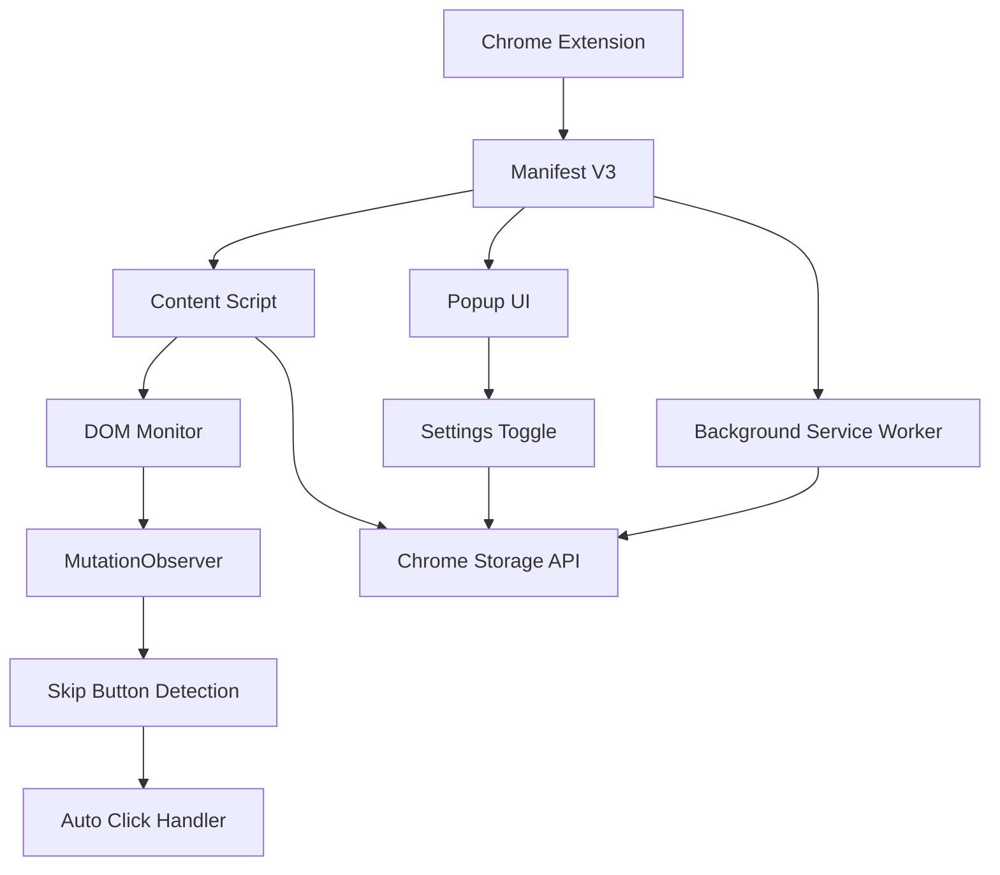

# 設計書: Netflix Intro Skipper

## 概要

Netflix Intro Skipper は、MutationObserver を使用して Netflix の DOM の変更を監視し、「イントロをスキップ」ボタンが表示されたときに自動的にクリックする Chrome 拡張機能です。Manifest V3 を使用し、コンテンツスクリプトとして動作します。

## アーキテクチャ



拡張機能は以下の主要コンポーネントで構成されます：

1. **Content Script**: Netflix ページに注入され、DOM 監視とボタンクリックを実行
2. **Popup UI**: ユーザーが機能のオン/オフを切り替えるためのインターフェース
3. **Background Service Worker**: 設定の管理とメッセージング
4. **Manifest**: 拡張機能の設定と権限の定義

## コンポーネントとインターフェース

### Content Script (content.js)

- **責任**: Netflix DOM の監視とスキップボタンの自動クリック
- **主要機能**:
  - MutationObserver による DOM 変更の監視
  - 複数の方法でのスキップボタン検出
  - 設定に基づく自動クリック実行
  - エラーハンドリングとログ出力

```javascript
interface SkipButtonDetector {
  detectButton(): HTMLElement | null;
  clickButton(button: HTMLElement): boolean;
  isEnabled(): Promise<boolean>;
}
```

### Popup UI (popup.html/popup.js)

- **責任**: ユーザー設定インターフェースの提供
- **主要機能**:
  - 自動スキップ機能のオン/オフ切り替え
  - 現在の設定状態の表示
  - Chrome Storage API との連携

```javascript
interface SettingsManager {
  getEnabled(): Promise<boolean>;
  setEnabled(enabled: boolean): Promise<void>;
  onSettingsChanged(callback: (enabled: boolean) => void): void;
}
```

### Background Service Worker (background.js)

- **責任**: 拡張機能の状態管理とメッセージング
- **主要機能**:
  - 設定の永続化
  - コンテンツスクリプトとポップアップ間の通信
  - 拡張機能のライフサイクル管理

## データモデル

### 設定モデル

```javascript
interface ExtensionSettings {
  autoSkipEnabled: boolean;
  lastUpdated: number;
}
```

### スキップボタン検出モデル

```javascript
interface SkipButtonInfo {
  element: HTMLElement;
  detectionMethod: "text" | "selector" | "aria-label";
  confidence: number;
}
```

## 正確性プロパティ

_プロパティとは、システムのすべての有効な実行において真であるべき特性や動作のことです。本質的に、システムが何をすべきかについての形式的な記述です。プロパティは、人間が読める仕様と機械で検証可能な正確性保証の橋渡しをします。_

### スキップボタン検出戦略

拡張機能は以下の複数の方法でスキップボタンを検出します：

1. **テキストベース検出**: ボタンのテキストコンテンツで検出

   - 日本語: "イントロをスキップ", "スキップ"
   - 英語: "Skip Intro", "Skip"
   - その他の言語対応

2. **CSS セレクター検出**: Netflix の既知の CSS クラスで検出

   - `.skip-credits-button`
   - `[data-uia="player-skip-intro"]`
   - `.watch-video--skip-content-button`

3. **ARIA 属性検出**: アクセシビリティ属性で検出
   - `aria-label` 属性
   - `role="button"` との組み合わせ

### 検証可能プロパティ一覧

プロパティ 1: スキップボタンの自動クリックとタイミング
_任意の_ スキップボタンが存在し自動スキップが有効な Netflix ページにおいて、拡張機能はボタンの表示から 1 秒以内に自動的にクリックする
**検証対象: 要件 1.1, 3.4**

プロパティ 2: スキップボタンがない場合の無動作
_任意の_ スキップボタンがない Netflix ページにおいて、拡張機能はクリックイベントをトリガーしない
**検証対象: 要件 1.3**

プロパティ 3: 複数動画セッションの処理
_任意の_ Netflix 動画再生シーケンスにおいて、拡張機能は各動画のスキップボタン検出とクリックを独立して処理する
**検証対象: 要件 1.4**

プロパティ 4: 無効状態の動作
_任意の_ 自動スキップが無効な Netflix ページにおいて、拡張機能はスキップボタンの存在に関係なく自動的にクリックしない
**検証対象: 要件 2.2**

プロパティ 5: 有効状態の動作
_任意の_ 自動スキップが有効な Netflix ページにおいて、拡張機能は自動スキップボタンクリック動作を再開する
**検証対象: 要件 2.3**

プロパティ 6: 設定の永続化
_任意の_ ユーザー設定において、拡張機能はブラウザセッション間で同じ設定値を維持する
**検証対象: 要件 2.4**

プロパティ 7: 複数方法による検出
_任意の_ 異なる識別方法（テキスト、CSS セレクター、ARIA ラベル）を使用するスキップボタンにおいて、拡張機能は正常にボタンを検出しクリックする
**検証対象: 要件 3.1, 3.2**

プロパティ 8: ドメイン制限
_任意の_ Netflix 以外のドメインにおいて、拡張機能は動作せずスキップボタン検出を実行しない
**検証対象: 要件 4.1**

プロパティ 9: 可視 UI の非注入
_任意の_ Netflix ページにおいて、拡張機能はページ DOM に可視的な UI 要素を追加しない
**検証対象: 要件 4.4**

プロパティ 10: エラーハンドリングと回復
_任意の_ 動作中に発生するエラー状況において、拡張機能はエラーをログに記録し、通常動作を継続し、未処理例外を投げない
**検証対象: 要件 5.1, 5.2, 5.3**

プロパティ 11: 再試行メカニズム
_任意の_ スキップボタン検出またはクリック試行の失敗において、拡張機能は諦める前に代替方法で再試行する
**検証対象: 要件 5.4**

## エラーハンドリング

### エラーカテゴリ

1. **DOM アクセスエラー**: ページ構造の予期しない変更
2. **ボタン検出失敗**: スキップボタンが見つからない
3. **クリック実行失敗**: ボタンクリックが失敗
4. **ストレージアクセスエラー**: 設定の読み書きエラー
5. **権限エラー**: 必要な権限が不足

### エラーハンドリング戦略

- すべてのエラーを console.error でログ出力
- エラー発生時も Netflix の機能を妨げない
- フォールバック機能で可能な限り動作継続
- ユーザーに対してはサイレントに失敗

## テスト戦略

### デュアルテストアプローチ

この拡張機能では、ユニットテストとプロパティベーステストの両方を使用します：

**ユニットテスト**:

- 特定のボタン検出シナリオのテスト
- 設定の保存・読み込み機能のテスト
- エラーハンドリングの具体的なケース
- DOM 操作の基本機能テスト

**プロパティベーステスト**:

- 様々な Netflix ページ構造での動作検証
- ランダムな設定状態での一貫した動作
- 異なるボタン表示パターンでの検出能力
- エラー条件での堅牢性

### プロパティベーステスト設定

- **テストライブラリ**: Jest (v29.7.0) with fast-check (v3.15.0) for property-based testing
- **テスト環境**: jsdom
- **最小反復回数**: プロパティテストあたり 100 回の反復
- **テストタグ付け**: 各テストは設計書のプロパティを参照
- **タグ形式**: `// Feature: netflix-intro-skipper, Property {number}: {property_text}`
- **カバレッジ収集**: `src/**/*.js` ファイル（テストファイルと node_modules を除外）

### テスト環境セットアップ

- **DOM シミュレーション**: Netflix ページ構造シミュレーション用の JSDOM (jest-environment-jsdom)
- **Chrome API モック**: chrome.storage と chrome.runtime API (@types/chrome v0.0.254)
- **MutationObserver モック**: DOM 変更シミュレーション用
- **タイミングテスト**: タイミングに敏感なテスト用のフェイクタイマー
- **テスト設定**: `tests/test-setup.js` でグローバル設定を管理

## 実装ノート

### Manifest V3 の考慮事項

- バックグラウンドページの代わりにサービスワーカー
- Netflix ドメイン用の宣言的コンテンツスクリプト
- 設定永続化用のストレージ API
- eval() やリモートコード実行なし

### パフォーマンス最適化

- デバウンスされた MutationObserver コールバック
- 効率的な CSS セレクタークエリ
- 最小限の DOM トラバーサル
- 検出方法の遅延読み込み

### 国際化

- 多言語スキップボタンテキスト検出
- 地域別 Netflix ドメインサポート
- ロケール対応エラーメッセージ
